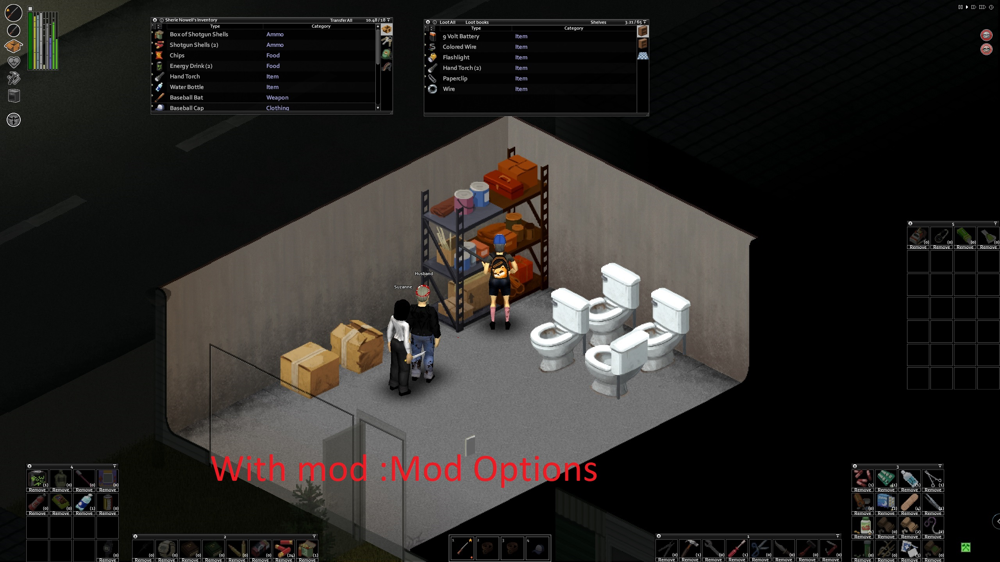
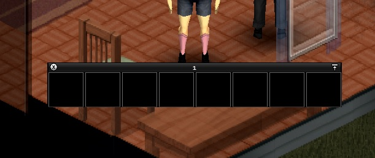
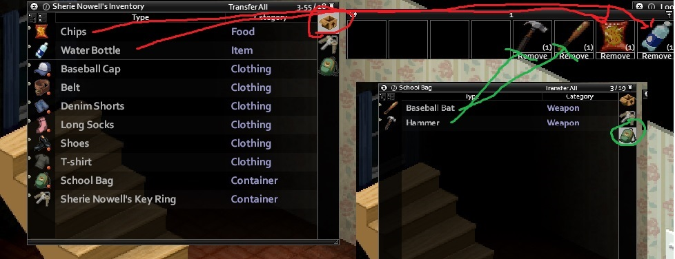
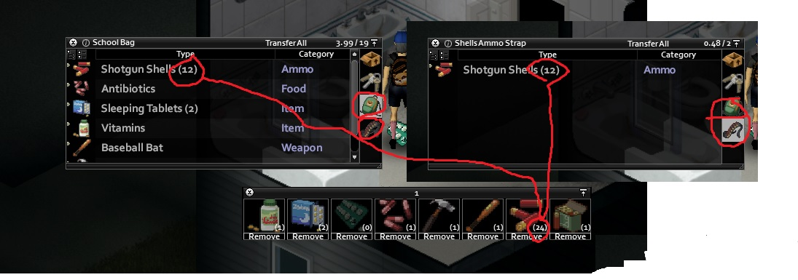
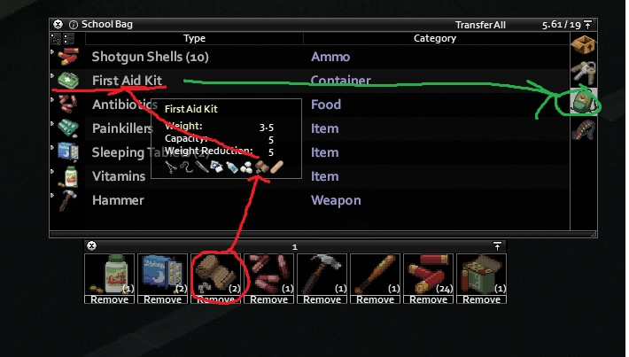
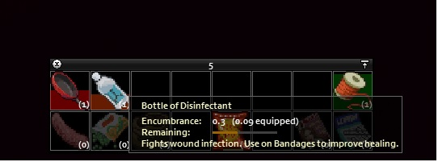
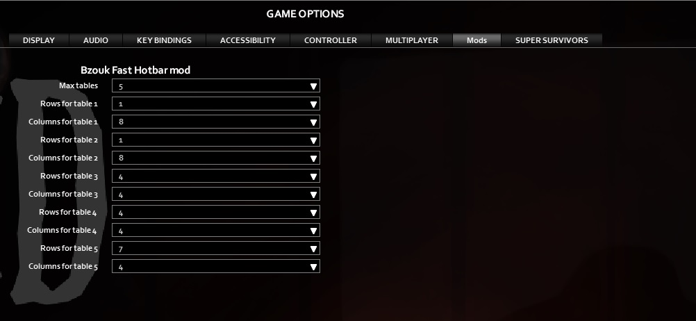
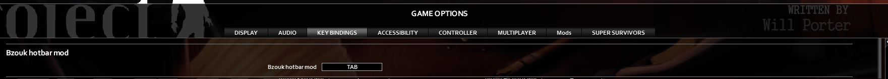

# BZQuickSlots

Quick access bars for Project Zomboid. Drag items from anywhere in your inventory into a
slot and use them with one click — no more digging through a backpack inside a backpack
for the one bandage you need.

Mod ID `pzhotbar42` · Build 42 · [Steam Workshop 3396010813](https://steamcommunity.com/sharedfiles/filedetails/?id=3396010813)



## What it does

A slot holds an *item type*, not an item. The item itself can stay wherever it lives —
in your main inventory, in a bag, or in a first aid kit inside that bag. The slot counts
every usable copy you are carrying and left-click reaches in and uses one.



Drag any item into a slot. You do not need to own the item to bind it.



The number on a slot counts non-broken items across every container on you, nested ones
included. Broken items are ignored — handle those in the inventory window.



Nested really does mean nested — bandages in a first aid kit in a school bag still count.



Hovering a slot shows the same info panel as the inventory.



> The screenshots are from the earlier Build 41 version. The layout and behaviour are the
> same; some Build 42 additions are not pictured yet.

## Using it

**Tab** shows and hides the bars. Bars drag around freely and use the same window frame as
the inventory panel (X to hide, pin to collapse).

**Right click** behaves exactly like right-clicking the item in the inventory.

**Left click** does the sensible thing for that item type, using the game's own actions.
Most actions put the item back where it came from when they finish:

```
1) Click a slot holding Disinfectant (the bottle is in a medkit in your backpack)
2) The bottle moves to your main inventory
3) It is applied to your damaged body parts
4) It goes back into the medkit in your backpack
```

If you cancel the action (start running, etc.) the item stays in your main inventory.

| Item | Left click |
|---|---|
| Food | Same as double-click in the inventory. Eats half, or the whole thing for cigarettes (needs a lighter). |
| Water and beverages | Drinks if you are thirsty and the fluid is not tainted. |
| Pills (BetaBlock, AntiDeb, Sleeping Tablets, Vitamins) | Takes one pill. |
| Disinfectant, Alcohol Wipes | Applies to every damaged body part that has no alcohol yet. |
| Dish Cloth, Bath Towel | Dries you off. |
| Thread | With a needle in your inventory, stitches all deep wounds. |
| Hand weapon | Equips it — two-handed if the weapon is. Optionally swaps whatever is in your hands into the weapon container. |
| Bandage (any bandaging item) | Cleans burns if the bandage is sterilised, otherwise bandages a damaged part. |
| Clothing | Equips it. |
| Literature | Starts reading. |
| Suture Needle Holder, Tweezers | Removes all glass and bullets from damaged parts. |
| Suture Needle | Stitches one deep wound. |
| Comfrey Cataplasm | Applies to a fractured part that has none. |
| Wild Garlic Cataplasm | Applies to one infected wound. |
| Plantain Cataplasm | Applies to one scratched, deep wounded or cut part. |
| Splint | Applies to a fractured part that has none. |
| Radio | Equips or unequips. |
| Anything else | Nothing — use right click. |

When several copies qualify, the mod picks the best one: for fluid containers it prefers
the ones you can actually pour from.

Ideas worth binding: ammo (the count tells you how many rounds you have), an ammo box
(right click to open), a watch (equip, then right click to set the alarm), crafting
materials, and spears — click the slot to re-equip a fresh one the moment the old one
breaks.

## Settings

Everything lives in the game's built-in **Mod Options** screen, under *Bz Quick slot mod*.
Build 42 provides that screen itself, so no extra mod is needed.



| Setting | Range | Default |
|---|---|---|
| Toggle keybind | any key | Tab |
| Number of bars | 1–5 | 1 |
| Rows / columns per bar | 1–10 each | bar 1 is 2×8, the rest 1×1 |
| Slot size | 45–90 px, step 5 | 65 |
| Bar opacity | 0–1, step 0.1 | 1 |
| Move weapons to the weapon container | on/off | on |
| Simple delete button | on/off | off |
| Show delete button | on/off | on |
| Show tooltip | on/off | on |
| Hide bars in a vehicle | on/off | off |
| Per-slot keybinds, bar 1 slots 1–9 | any key | unbound |



Settings are stored in `pzhotbar.ini`. On first run the mod imports the original Lua
mod's `bzhotbar.ini` if it finds one.

## Installing

Subscribe on the workshop, then enable **BZQuickSlots** in the mod list. No dependencies —
Blindcoder's Modding Utility is no longer required, its INI helpers ship inside the mod.

**Do not run this alongside the older versions of the mod.** They fight over the same bars.

## Versions

| Version | Build | Workshop | Source |
|---|---|---|---|
| BZQuickSlots (this one) | B42 | [3396010813](https://steamcommunity.com/sharedfiles/filedetails/?id=3396010813) | `main` |
| BzoukPzHotBarNew | B41 | [3133189049](https://steamcommunity.com/sharedfiles/filedetails/?id=3133189049) | tag `v0.1.4-b41` |
| Original Lua mod | B41 | [2434425002](https://steamcommunity.com/sharedfiles/filedetails/?id=2434425002) | archived repo `pz-bzoukhotbar` |

What Build 42 changed: the mod moved to the [B42 folder structure](https://pzwiki.net/wiki/Folders_structure),
switched to the built-in Mod Options API, gained per-slot keybinds, bar opacity, a
hide-in-vehicle option, and it now understands the B42 fluid system — slots show the fill
level of bottles and drinking goes through the fluid API.

## Languages

English, Czech, French (@Bobitec + Google), Spanish (@WhiteLotus + Google), Chinese, Russian.

## Known issues

- Items that share a display name are grouped together by the game even when they are
  different items.
- Right-click crafting needs the items in your main inventory or a bag — a game mechanic,
  not something the bar can work around.

## Building

Written in TypeScript and compiled to Lua with
[PipeWrench](https://github.com/asledgehammer/PipeWrench) via
[PZPW](https://github.com/Konijima/pzpw) and the
[PZPW compiler](https://github.com/Konijima/pzpw-compiler). The repo started from the
[Konijima template](https://github.com/Konijima/pzpw-template);
its [tutorial](https://github.com/Konijima/pzpw/wiki/Tutorial:-Creating-Project-Zomboid-mods-using-PZPW)
covers the setup.

```bash
npm install
npm install -g pzpw-compiler   # or npm run install-compiler for the instructions
npm run compile-mods           # build the mod into the game's cache dir
```

| Script | Does |
|---|---|
| `npm run test-build` | Type-check only, no output |
| `npm run compile-mods` | Compile the mods |
| `npm run compile-workshop` | Compile for the workshop |
| `npm run update-compiler` | Update the PZPW compiler |
| `npm run clean-all` | Clean project and cache dir |
| `npm run clean-project` | Clean generated project content |
| `npm run clean-cachedir-mods` | Clean generated mod dirs in the cache dir |
| `npm run clean-cachedir-workshop` | Clean the workshop dir in the cache dir |

## Credits

The idea comes from [Hotbar for 5-20 often-used](https://steamcommunity.com/sharedfiles/filedetails/?id=503645367)
by Blindcoder, and from quickbars in other games.

MIT © Bzouk
